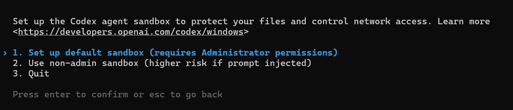

# Codex CLI 第三方 API 配置备忘

[Codex CLI](https://github.com/openai/codex) 是 OpenAI 官方推出的终端 AI Agent 工具，支持代码生成、文件操作等。本文记录如何配置第三方 api。

## 1. 安装
下面方式任选其一，安装完成后可以在终端执行 `codex --version` 查看版本，可以参考[菜鸟教程](https://www.runoob.com/codex/codex-install.html)。
### 1.1 脚本安装
- `windows` 安装:
```pwsh
# 网络不通需要自己使用代理 例如开启clash
powershell -ExecutionPolicy ByPass -c "irm https://chatgpt.com/codex/install.ps1 | iex"
```
- `linux/mac`安装
```bash
# 网络不通需要自己使用代理
# 例如: export https_proxy=http://127.0.0.1:7890 && export http_proxy=http://127.0.0.1:7890
curl -fsSL https://chatgpt.com/codex/install.sh | sh
```

### 1.2 包管理器安装
还可以通过包管理器安装，安装步骤如下：
- `windows/linux`安装:
  - `nodejs`安装可以参考[菜鸟教程](https://www.runoob.com/nodejs/nodejs-install-setup.html)：具体来说，`codex-cli` 可以依赖 nodejs 环境安装， `nodejs`的`windows`版本，直接从[官网](https://nodejs.org/en/download/)下载`msi`后缀包安装，安装完成后执行 `node -v` 查看版本，或者通过`pwsh`命令行`winget install -e --id OpenJS.NodeJS.LTS`安装，参考[博客](https://zhuanlan.zhihu.com/p/1970615672196276433)。 
  下面是`linux`安装步骤：
    ```bash
    # 1. 使用nvm包管理器安装 Node.js  !!已有可忽略
    curl -o- https://raw.githubusercontent.com/nvm-sh/nvm/master/install.sh | bash # 如果没有nvm
    # 激活nvm 这里是zsh的配置，如果是bash请修改~/.bashrc
    echo '
    export NVM_DIR="$HOME/.nvm"
    [ -s "$NVM_DIR/nvm.sh" ] && \. "$NVM_DIR/nvm.sh"' >> ~/.zshrc
    export NVM_DIR="$HOME/.nvm"
    [ -s "$NVM_DIR/nvm.sh" ] && \. "$NVM_DIR/nvm.sh"
    [ -s "$NVM_DIR/bash_completion" ] && \. "$NVM_DIR/bash_completion"
    source ~/.zshrc
    nvm --version # 验证nvm
    export NVM_NODEJS_ORG_MIRROR=https://npmmirror.com/mirrors/node # 设置镜像源
    # 如果nodejs版本过低，可以使用nvm安装最新版本的nodejs
    nvm install 20 # 安装nodejs 20版本
    ```
  - `codex`安装
    ```bash
    # 使用 npm 安装 (linux/windows)
    npm install -g @openai/codex

    # 验证安装
    codex --version
    # codex-cli 0.117.0 # 输出版本 安装成功
    ```
  - 宿主机的非`root`用户安装：
    ```bash
    # 1. 设置 npm 的用户级全局目录
    mkdir -p "$HOME/.local"
    npm config set prefix "$HOME/.local"
  
    # 2. 添加索引路径，如果使用 Bash 添加到 ~/.bashrc
    echo 'export PATH="$HOME/.local/bin:$PATH"' >> ~/.zshrc
    source ~/.zshrc
  
    # 3. 安装 Codex
    npm install -g @openai/codex@latest
  
    # 4. 验证
    command -v codex
    codex --version
    ```

- `mac`安装
  ```bash
  # Install using Homebrew
  brew install --cask codex
  ```

## 2. cc-switch 配置第三方 API
直接修改配置文件容易出现各种问题，推荐使用 [cc-switch](https://github.com/farion1231/cc-switch)统一管理, 桌面版使用可以参考[菜鸟教程](https://www.runoob.com/vibe-coding/cc-switch.html)
### 2.1 安装 cc-switch

- [windows cli版本](https://github.com/SaladDay/cc-switch-cli/releases)安装演示如下，[release 界面获取](https://github.com/SaladDay/cc-switch-cli/releases)复制对应的下载版本连接，参考下面内容：
```pwsh
# 1. 创建临时目录并下载最新版
$downloadUrl = "https://github.com/SaladDay/cc-switch-cli/releases/latest/download/cc-switch-cli-windows-x64.zip"
$zipPath = "$env:TEMP\cc-switch-cli.zip"
$extractPath = "$env:TEMP\cc-switch-extract"
Invoke-WebRequest -Uri $downloadUrl -OutFile $zipPath

# 2. 解压
Expand-Archive -Path $zipPath -DestinationPath $extractPath -Force

# 3. 移动到用户 PATH 目录（无需管理员权限）
$binPath = "$env:LOCALAPPDATA\Microsoft\WindowsApps"
if (!(Test-Path $binPath)) { New-Item -ItemType Directory -Path $binPath -Force }
Copy-Item "$extractPath\cc-switch.exe" -Destination $binPath -Force

# 4. 验证安装
cc-switch --version
# cc-switch 5.2.1 # 输出版本 安装成功
```
- [Linux CLI 版本](https://github.com/SaladDay/cc-switch-cli)，下面具体获取的包需要在 [release 界面获取](https://github.com/SaladDay/cc-switch-cli/releases)，优先获取 musl 静态编译版。

```bash
# 1. 直接脚本安装方式
curl -fsSL https://github.com/SaladDay/cc-switch-cli/releases/latest/download/install.sh | bash

# 2. 下载解压方式
curl -LO https://github.com/SaladDay/cc-switch-cli/releases/download/v4.5.0/cc-switch-cli-v4.5.0-linux-x64-musl.tar.gz

tar -xzf cc-switch-cli-*.tar.gz # 解压
rm cc-switch-cli-*.tar.gz # 删除压缩包
chmod +x cc-switch # 执行权限
sudo mv cc-switch /usr/local/bin/ # 放到系统路径
```

### 2.2 设置 API Key
参考[文档](https://github.com/SaladDay/cc-switch-cli) (有[中文版](https://github.com/SaladDay/cc-switch-cli/blob/main/README_ZH.md))，输入对应的模型提供商、URL、模型 ID、接口令牌等信息。**部分自己搭建的第三方api的`base_url`需要加`/v1`，不然请求可能会自动路由到`/login`的返回界面**，流程大概如下，对照注释查看

```bash
➜  cc-switch --app codex provider add # 添加新供应商 这里需指定app为codex
Add New Provider
==================================================
> Select provider type: Add Third-Party Provider # 得选择到第三方供应商
> Provider Name: example
> Website URL (opt.):
Generated ID: example

Configure Codex Provider:
> OpenAI API Key: sk-abababababababababababababab # 站点的key
> Base URL: http://example.com/v1 # 注意这里部分自建站点需要加/v1 同时注意这里的协议
> Model: gpt-5.5 # 选择模型
> Configure optional fields (notes,  sort index)? No # 可以跳过

=== Provider Configuration Summary ===
ID: example
Provider Name:: example

Core Configuration:
  API Key: sk-b...ecdf
  Config (TOML): 10 lines
======================
>
Confirm create this provider? Yes # 确认配置

✓ Successfully added provider 'example' 

# 再查看就有了
➜  cc-switch provider list --app codex # 同样指定codex                                    
┌───┬──────────┬──────────┬────────────────────────────────────┐
│   ┆ ID       ┆ Name     ┆ API URL                            │
╞═══╪══════════╪══════════╪════════════════════════════════════╡
│ ✓ ┆ example  ┆ example  ┆ http://example.com/v1              │
└───┴──────────┴──────────┴────────────────────────────────────┘

ℹ Application: codex
→ Current: example # 当前使用的 example

# 在打开 codex 就可以使用了
➜ codex
```

### 2.3 配置 Skill

Skill 包含如下结构，可以理解为高级提示词。参考tutorial: [官方文档](https://support.claude.com/en/articles/12512180-using-skills-in-claude-code)、[中文tutorial](https://www.runoob.com/ai-agent/skills-agent.html)

```
skill-name/
├── SKILL.md          # Required: Skill instructions and metadata
├── scripts/          # Optional: Helper scripts
├── templates/        # Optional: Document templates
└── resources/        # Optional: Reference files
```

可以在开源仓库/社区获取 Skills，如：

- [Awesome Claude Skills](https://github.com/ComposioHQ/awesome-claude-skills)
- [skillsmp](https://skillsmp.com/)
- [skills.sh](https://skills.sh/)

把下载好的 Skill 放到 Codex CLI 的 skills 目录就可以在 Codex CLI 中通过`/skills`命令启用，另外同样可以通过cc-switch统一管理，方便在不同模型间切换。

下面以 [matplotlib](https://skills.sh/davila7/claude-code-templates/matplotlib) 为例，右边有 install 命令：

```bash
➜  npx skills add https://github.com/davila7/claude-code-templates --skill matplotlib
```
安装完成后可以导入`cc-switch`中统一管理：

```bash
# 扫描未管理的技能
➜ cc-switch skills scan-unmanaged  --app codex 
┌─────────────┬──────────┬─────────────┐
│ Directory   ┆ Found In ┆ Name        │
╞═════════════╪══════════╪═════════════╡
│ find-skills ┆ agents   ┆ find-skills │
├╌╌╌╌╌╌╌╌╌╌╌╌╌┼╌╌╌╌╌╌╌╌╌╌┼╌╌╌╌╌╌╌╌╌╌╌╌╌┤
│ matplotlib  ┆ agents   ┆ matplotlib  │
└─────────────┴──────────┴─────────────┘

# 导入到cc-switch中统一管理
➜ cc-switch skills import-from-apps find-skills
✓ Imported 1 skill(s) into SSOT
➜ cc-switch skills import-from-apps matplotlib
✓ Imported 1 skill(s) into SSOT

# 查看已导入的技能
➜ cc-switch skills list            
┌─────────────┬─────────────┬────────┬───────┬────────┬──────────┐
│ Directory   ┆ Name        ┆ Claude ┆ Codex ┆ Gemini ┆ OpenCode │
╞═════════════╪═════════════╪════════╪═══════╪════════╪══════════╡
│ find-skills ┆ find-skills ┆        ┆       ┆        ┆          │
├╌╌╌╌╌╌╌╌╌╌╌╌╌┼╌╌╌╌╌╌╌╌╌╌╌╌╌┼╌╌╌╌╌╌╌╌┼╌╌╌╌╌╌╌┼╌╌╌╌╌╌╌╌┼╌╌╌╌╌╌╌╌╌╌┤
│ matplotlib  ┆ matplotlib  ┆        ┆       ┆        ┆          │
└─────────────┴─────────────┴────────┴───────┴────────┴──────────┘

# 通过cc-switch启用技能
➜ cc-switch skills enable matplotlib --app codex
✓ Enabled 'matplotlib' for codex
➜ cc-switch skills enable find-skills --app codex
✓ Enabled 'find-skills' for codex
➜ cc-switch skills list 
┌─────────────┬─────────────┬────────┬───────┬────────┬──────────┐
│ Directory   ┆ Name        ┆ Claude ┆ Codex ┆ Gemini ┆ OpenCode │
╞═════════════╪═════════════╪════════╪═══════╪════════╪══════════╡
│ find-skills ┆ find-skills ┆        ┆ ✓     ┆        ┆          │
├╌╌╌╌╌╌╌╌╌╌╌╌╌┼╌╌╌╌╌╌╌╌╌╌╌╌╌┼╌╌╌╌╌╌╌╌┼╌╌╌╌╌╌╌┼╌╌╌╌╌╌╌╌┼╌╌╌╌╌╌╌╌╌╌┤
│ matplotlib  ┆ matplotlib  ┆        ┆ ✓     ┆        ┆          │
└─────────────┴─────────────┴────────┴───────┴────────┴──────────┘
```

## 3 Codex 使用
```bash
# 启动交互模式
codex
```
第一次启动需要选择运行模式，建议使用沙盒模式`Set up default sandbox`，隔离环境更安全。


### 3.1 基本使用

```bash
# 启动交互模式 通常使用这个方式执行
codex

# 指定模型
codex --model gpt-4o

# 执行单条命令
codex "创建一个 Python 脚本读取 JSON 文件"

# 非交互模式（自动执行）
codex --full-auto "帮我重构这个函数"
```

### 3.2 常用命令
```bash
/init       # 生成一个AGENTS.md文件 记录这个项目大致情况
/resume     # 恢复上次会话
/ps         # 查看后台terminal
/stop       # 停止后台terminal
/approvals  # 授权
/skills     # 管理技能
/models     # 切换模型 这里可以调整思考模式 例如high extrahigh
/statusline # 状态底栏的显示 空格选中 enter保存 esc取消
# `Alt + V` # 把图片粘贴到 Codex CLI
/memory     # 记忆功能 需要手动打开
/keymap     # 快捷键映射 可以修改
/vim        # 当前支持 vim 模式
/plan       # plan模式 先写一个目标 codex会帮你规划 然后执行
/goal       # goal模式 先写一个目标 codex会一直帮你执行 直到完成目标
/side       # side模式 在当前窗口新开一个对话 可以返回ctrl+c返回原来对话
```

## 4. rtk

[rtk](https://www.rtk-ai.app/) 可以在`codex`命令输出进入上下文窗口之前对其进行压缩。 更好的推理。更长的会话。更低的成本。

### 4.1 Linux

`rtk` 的 shell hook 能自动把常见命令重写成 `rtk ...`，并根据结果压缩上下文。

```bash
# 快速安装
curl -fsSL https://raw.githubusercontent.com/rtk-ai/rtk/refs/heads/master/install.sh | sh

# 初始化 Codex
rtk init -g --codex

# 重启 codex 后测试
rtk --version
rtk gain
```

### 4.2 Windows 原生 PowerShell

Windows 原生也能用 `rtk`，需要下载解压预编译包`rtk-x86_64-pc-windows-msvc.zip`,
- 对 Codex 的集成方式是 `rtk init -g --codex`
- Codex 这一项的官方集成方式是 `AGENTS.md + RTK.md instructions`

也就是说，对 Codex 而言，核心是给 Codex 注入使用 `rtk` 的规则，而不是依赖 bash hook。

安装步骤：

```powershell
# 1. 下载 release 里的 Windows 压缩包
# https://github.com/rtk-ai/rtk/releases

# 2. 解压后把 rtk.exe 放进 PATH
# 例如：C:\Users\xxx\.local\bin

# 3. 验证
rtk --version

# 4. 初始化 Codex
rtk init -g --codex

# 5. 重启 Codex 后查看统计
rtk gain
```

### 4.3 常用命令

```bash
# rtk 包装命令
rtk git status
rtk git diff
rtk find . -n '*.md'
rtk grep 'pattern' .
rtk read README.md
# 查看rtk压缩收益
rtk gain
```

更多命令与支持矩阵见：[rtk仓库](https://github.com/rtk-ai/rtk)

## 5. 避免命令污染

### 5.1 Linux(zsh)

`codex` 执行命令也会记录在 `zsh` 历史中，污染平时使用的`shell`命令。Linux 下可以把 `codex` 执行的命令单独写到隔离的 `HISTFILE`，再按需清理旧历史, 整理脚本如下：

 
```bash
git clone https://github.com/huluhuluu/useful-sh.git
./sh/codex-zsh-history-isolation/codex-zsh-history-isolation.sh # 设置修改codex命令隔离

# 可选 清理部分历史命令
./sh/zsh-history-prune/zsh-history-prune.sh
./sh/zsh-history-prune/zsh-history-prune.sh --apply

```

原理：

1. 修改 `~/.codex/config.toml`
2. 把 shell 历史写到独立 `HISTFILE`
3. 创建最小化 `ZDOTDIR`
4. 控制 Codex 自己的 `[history].persistence`

## 6. codegraph
[codegraph](https://github.com/colbymchenry/codegraph) 可以预先给代码构建图谱，更加有利于`agent`执行时理解代码
### 6.1 安装
第一步，下载codegraph:
```bash
# macOS / Linux
curl -fsSL https://raw.githubusercontent.com/colbymchenry/codegraph/main/install.sh | sh

# Windows (PowerShell)
irm https://raw.githubusercontent.com/colbymchenry/codegraph/main/install.ps1 | iex
```

第二步，接入`agent`使用:
```bash
# 会自动查找`agent` 需要通过键盘选择要接入的`agent`
codegraph install
```

### 6.2 使用
常规使用，进入项目进行初始化，这会生成一个`.codegraph`目录存放图谱:
```bash
cd your-project
codegraph init
```
代码修改多了以后可以更新图谱
```bash
codegraph sync
```

## 6. sivtr

[sivtr](https://github.com/Ariestar/sivtr) 是一个本地 workspace memory 工具，可以记录终端命令输出、AI coding session、工具日志等内容。它适合和 Codex 一起用：Agent 不需要让你手动粘贴最近的报错，而是先从本地记录里搜索证据。

Agent 工作流建议同时安装两部分：

- `sivtr` CLI/TUI：负责捕获和检索本地记录
- `sivtr-memory` skill：告诉 Agent 什么时候、怎么使用 `sivtr`（当前版本codex带memory功能通过`/memory`可以使用 可以不适用这个功能）

### 6.1 Windows 安装

Windows 推荐用 Cargo 安装 CLI，然后初始化 PowerShell hook。需要先有 Rust/Cargo 环境，可以从 [Rust 官网](https://www.rust-lang.org/tools/install) 安装。

```powershell
# 1. 安装 sivtr
cargo install sivtr

# 2. 验证
sivtr --version

# 3. 初始化 PowerShell hook
sivtr init powershell

# 4. 创建默认配置
sivtr config init

# 5. 安装 Agent memory skill
npx skills add Ariestar/sivtr --skill sivtr-memory -g

# 6. 诊断
sivtr doctor
```

安装 hook 后需要重启 PowerShell。Windows 的全局热键 daemon 是内置支持的，默认热键是 `alt+y`：

```powershell
# 启动 Windows 全局热键
sivtr hotkey start

# 指定快捷键
sivtr hotkey start --chord ctrl+shift+y

# 只打开 Codex picker
sivtr hotkey start --provider codex

# 查看/停止
sivtr hotkey status
sivtr hotkey stop
```

### 6.2 Linux/macOS 安装

Linux/macOS 可以用 Cargo 安装，也可以用官方脚本下载预编译二进制。

```bash
# 方式一：Cargo 安装，需要 Rust/Cargo
cargo install sivtr

# 方式二：预编译二进制，安装到 ~/.local/bin/sivtr 或 $SIVTR_INSTALL_DIR
curl -fsSL https://raw.githubusercontent.com/Ariestar/sivtr/main/install.sh | sh

# 验证
sivtr --version

# 初始化 shell hook，按实际 shell 选择一个
sivtr init bash
sivtr init zsh
sivtr init nushell

# 创建默认配置
sivtr config init

# 安装 Agent memory skill
npx skills add Ariestar/sivtr --skill sivtr-memory -g

# 诊断
sivtr doctor
```

macOS 通常使用 `zsh`，Linux 服务器上按实际 shell 选择 `bash` 或 `zsh`。初始化 hook 后重启终端。

### 6.3 常用命令

```bash
# 打开交互面板
sivtr

# 捕获并浏览一段输出
cargo test 2>&1 | sivtr
sivtr run cargo test

# 复制最近终端命令块
sivtr copy
sivtr copy out --print
sivtr copy cmd --pick

# 从 Codex session 中复制内容
sivtr copy codex
sivtr copy codex out --pick

# 搜索最近的终端失败记录
sivtr s terminal --status failure --latest 1 --refs

# 搜索 Agent session
sivtr s agent -m "TODO|failed|decision" --since today -f timeline

# 查看配置和 hook
sivtr config show
sivtr init show
sivtr doctor
```

## 7. herdr

[herdr](https://herdr.dev/) 是面向 AI coding agents 的终端 multiplexer，可以理解为更适合 Agent 工作流的 `tmux`。它会把不同项目、tab、pane 和 Agent 状态集中在一个终端界面里，适合同时跑多个 Codex/Claude/OpenCode 等 session。

### 7.1 Windows 安装

Herdr 的稳定版目前支持 Linux/macOS，Windows 是 preview beta。Windows 直接使用官方 preview 安装脚本：

```powershell
powershell -ExecutionPolicy Bypass -c "irm https://herdr.dev/install.ps1 | iex"

# 验证
herdr
```

Windows beta 默认使用 preview channel。后续更新使用：

```powershell
herdr update
```

### 7.2 Linux/macOS 安装

Linux/macOS 推荐直接用官方安装脚本，Homebrew、mise、Nix 用户也可以用对应包管理器。

```bash
# 官方安装脚本
curl -fsSL https://herdr.dev/install.sh | sh

# Homebrew
brew install herdr

# mise
mise use -g herdr

# Nix
nix run github:ogulcancelik/herdr

# 验证
herdr
```

手动下载**也可以**从 [GitHub Releases](https://github.com/ogulcancelik/herdr/releases) 选择对应二进制：

| 系统 | 文件 |
|------|------|
| Linux x86_64 | `herdr-linux-x86_64` |
| Linux aarch64 | `herdr-linux-aarch64` |
| macOS Intel | `herdr-macos-x86_64` |
| macOS Apple silicon | `herdr-macos-aarch64` |
| Windows x86_64 beta | `herdr-windows-x86_64.exe` |

Linux/macOS 手动安装示例：

```bash
chmod +x herdr-linux-x86_64
mv herdr-linux-x86_64 ~/.local/bin/herdr
```

### 7.3 设置默认启动 shell

Herdr 默认读取配置文件：

```text
~/.config/herdr/config.toml
```

可以先导出完整默认配置：

```bash
mkdir -p ~/.config/herdr
herdr --default-config > ~/.config/herdr/config.toml
```

然后在配置中设置新建交互 pane 使用的默认 shell：

```toml
[terminal]
default_shell = "zsh"
shell_mode = "auto"
```

`default_shell` 是可执行文件名或路径，不是一整段 shell 命令。常见写法(快捷键绑定也可以手动在这个`config`修改)：

```toml
[terminal]
default_shell = "bash"
```

```toml
[terminal]
default_shell = "zsh"
```

```toml
[terminal]
default_shell = "pwsh"
```

如果为空，Herdr 会按 `$SHELL`，再到 `/bin/sh` 的顺序回退。`shell_mode = "auto"` 会在 macOS 上使用 login shell，便于加载 Homebrew 等 PATH 初始化；其它平台保持非 login shell 行为。修改配置后重载：

```bash
herdr server reload-config
```

已有 pane 不会自动换 shell，需要新建 pane 或重启 session。

### 7.4 常用方法

```bash
# 启动或重新连接默认 session
herdr

# 远程连接，在本地终端作为远程 Herdr server 的 client
herdr --remote workbox
herdr --remote ssh://you@yourserver:2222

# 更新官方脚本安装的版本
herdr update

# 停止默认 session
herdr server stop

# 查看默认配置
herdr --default-config
```

默认快捷键类似 `tmux` 的 prefix 模型，`ctrl+b` 进入 prefix mode：

| 操作 | 快捷键 |
|------|--------|
| 新建 workspace | `ctrl+b` 后 `shift+n` |
| 新建 tab | `ctrl+b` 后 `c` |
| 左右/上下分屏 | `ctrl+b` 后 `v` / `minus` |
| workspace 选择 | `ctrl+b` 后 `w` |
| detach | `ctrl+b` 后 `q` |
| 查看全部快捷键 | `ctrl+b` 后 `?` |

在 pane 里直接运行 `codex`，Herdr 会自动识别 Agent 状态：

```bash
codex
```

---

## 参考链接

- [Codex CLI GitHub](https://github.com/openai/codex)
- [Codex Config Reference](https://developers.openai.com/codex/config-reference)
- [Codex Config Schema](https://developers.openai.com/codex/config-schema.json)
- [OpenAI API 文档](https://platform.openai.com/docs)
- [CC-Switch-cli](https://github.com/SaladDay/cc-switch-cli)
- [rtk GitHub](https://github.com/rtk-ai/rtk)
- [rtk](https://www.rtk-ai.app/)
- [sivtr GitHub](https://github.com/Ariestar/sivtr)
- [sivtr 中文文档](https://sivtr.pages.dev/zh-cn/)
- [Herdr](https://herdr.dev/)
- [Herdr GitHub](https://github.com/ogulcancelik/herdr)
