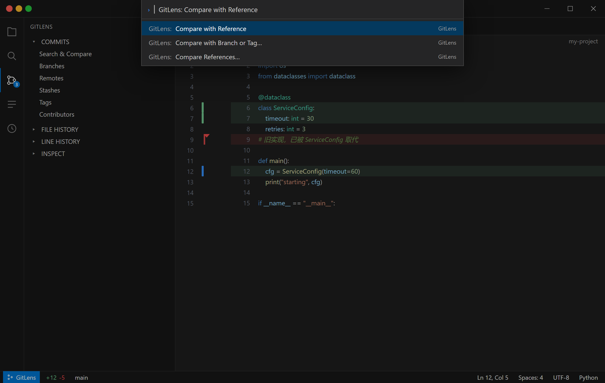
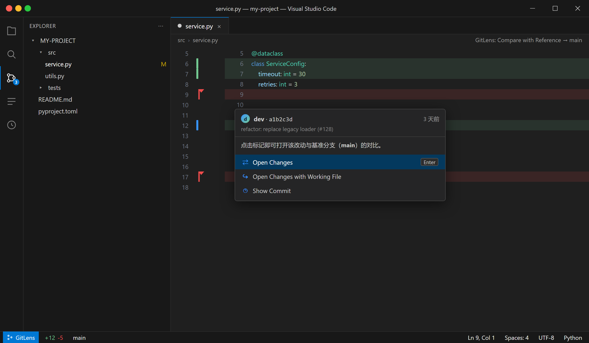
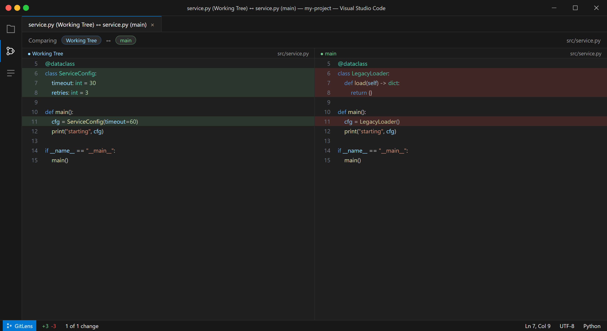
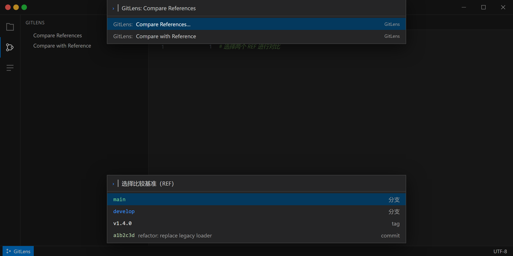
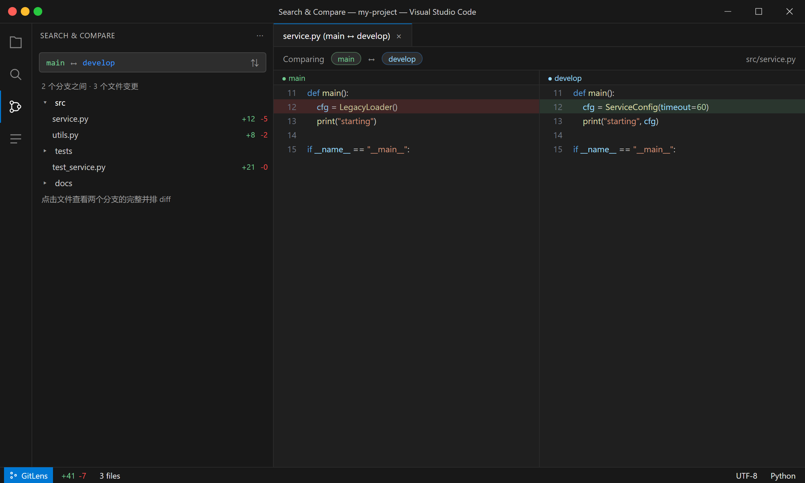
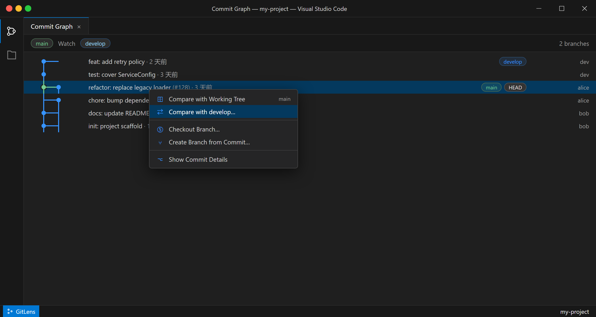

# GitLens 插件使用指南

[GitLens](https://marketplace.visualstudio.com/items?itemName=eamodio.gitlens) 是 VSCode 里最流行的 Git 增强插件（GitKraken 出品，安装量 5200W+），开箱即用的社区版免费。本文记录几个「对比代码 / 对比指定分支」的核心用法，特别是「只显示一个版本 + 左侧绿/红标注 + 点击看 diff」这套工作流。

安装命令：`Vscode` 命令面板（`ctrl+shift+p`）输入：

```bash
ext install eamodio.gitlens
```

下面截图为**脱敏演示**：仓库名、文件名、账号、提交信息均为虚构样例（`my-project` / `src/service.py` / `main`、`develop`），仅用于说明界面位置与操作流程。

## 1. 对比指定分支：Compare with Reference

这是最贴合「只显示指定分支/版本的某一侧内容，再点开对比」的场景。它把当前文件和一个「基准 REF」（某个分支、tag、commit）建立比较上下文，然后只显示**一个版本**，在编辑器左侧 gutter 用**绿/红**标出差异，**点击标记即可打开两个版本的 diff**。

### 1.1 建立比较上下文

`ctrl+shift+p` 输入并执行：

```
GitLens: Compare with Reference
```

命令面板里对应的条目：


依次选择两次 REF：

1. 第一个选择框：选「要对比的**指定分支**」，例如 `origin/main`、`develop`，或任意 tag、commit。
2. 第二个选择框：选「当前要看的版本」，通常是 `HEAD` 或工作区。

这样 GitLens 就建立了「指定分支 ↔ 当前版本」的比较上下文，后续所有文件标注都会**按这个指定分支**来计算。

### 1.2 开启 Recent Changes 标注

打开任意文件，`ctrl+shift+p` 执行：

```
GitLens: Toggle File Annotations
```

选择 **Recent Changes（近期改动）**。之后编辑器只显示「当前版本」的内容，但左侧 gutter 会用颜色标出相对指定分支的改动：



| 颜色 | 含义 |
| :--- | :--- |
| 🟢 绿色 | 当前版本**新增**的代码（指定分支里没有） |
| 🔴 红色 | 指定分支里有、但当前版本**已删除**的代码 |
| 🟡 黄/橙色 | 被**修改**过的内容 |

需要注意的是：颜色深浅也表示改动的新旧——颜色越深表示**越近几年内**的改动，颜色越浅表示越久远。这能帮你在「只看一个版本」时快速感知哪些区域动过、动得多频繁。

### 1.3 点击标记看 diff

把鼠标移到 gutter 的彩色标记或对应行上，会弹出 hover 气泡显示改动详情；点击行内或右键选择 **Open Changes / Open Changes with Working File**，就会打开一个 diff 视图，把「指定分支版本 ↔ 当前版本」两段代码**左右并排**对比给你看。

点击红色（删除）标记后的效果，左右两边分别是「当前版本」和「基准分支 `main`」：



## 2. 自由对比任意两个 REF：Compare References

如果你要对比的不是「指定分支 vs 工作区」，而是**任意的两个历史提交 / 两个分支 / tag**，用：

```
GitLens: Compare References
```

它允许你在两侧各自选择任意 REF（分支、tag、commit），比 `Compare with Reference` 更自由，适合「两个历史提交到底改了什么」「两个 tag 之间的差异」这类场景。



## 3. 对比两个分支的全部变更文件：Search & Compare

如果想知道「两个分支之间**所有**改动的文件列表」，用侧边栏的 Search & Compare：

1. 点 VSCode 左侧 GitLens 图标，打开 **Search & Compare（搜索与比较）** 视图。
2. 选择两个分支 / tag / commit，GitLens 会列出**两个版本之间的全部变更文件**。
3. 点进每个文件，就能看到该文件在两个分支下的**完整并排 diff**。



这种方式适合「先看改了哪些文件，再逐个深入」的审阅流程。

## 4. 在提交图上对比分支：Commit Graph

GitLens 的 **Commit Graph（提交图）** 也能做分支对比：

1. 打开 GitLens 视图，进入 Commit Graph。
2. 右键某个分支 / 提交节点，选择 **Compare with Working Tree** 或 **Compare with ...**。
3. 提交图上会散开显示两个 REF 之间的提交差异，方便看清「谁先谁后、差了几个提交」。



公共仓库的 Commit Graph 免费；私有仓库需要登录 GitKraken 账号或开通 Pro。如果只需要命令和标注功能，社区版就已足够。

## 5. 推荐配置

让「单版本 + 绿红标注」更顺手，可以往 `settings.json` 加：

```jsonc
{
  // 让 Recent Changes 点击行为更顺手
  "gitlens.fileAnnotations.command": "gitlens.toggleFileRecentChanges",
  "gitlens.advanced.fileAnnotationsDelay": 500,

  // hover 时显示改动动作按钮
  "gitlens.hovers.actions": true
}
```

如果想让「打开文件时默认就显示 Recent Changes」而不是每次手动切换，可以在 `keybindings.json` 给 `gitlens.toggleFileRecentChanges` 绑定常用快捷键，例如：

```jsonc
{
  "key": "ctrl+alt+r",
  "command": "gitlens.toggleFileRecentChanges"
}
```

## 6. 关键命令速查

| 目的 | 命令 |
| :--- | :--- |
| 安装插件 | `ext install eamodio.gitlens` |
| 选指定分支作为对比基准 | `GitLens: Compare with Reference` |
| 自由选任意两个 REF 对比 | `GitLens: Compare References` |
| 编辑器内只显示一个版本 + 绿/红标改 | `GitLens: Toggle File Annotations` → Recent Changes |
| 点标记弹出两版本 diff | 行内 hover / 右键 → Open Changes |
| 列出两个分支全部变更文件 | GitLens 侧边栏 → Search & Compare |

---

## 参考链接

- [GitLens Marketplace](https://marketplace.visualstudio.com/items?itemName=eamodio.gitlens)
- [GitLens GitHub](https://github.com/gitkraken/vscode-gitlens)
- [GitLens Help Center](https://help.gitkraken.com/gitlens/gitlens-home/)
