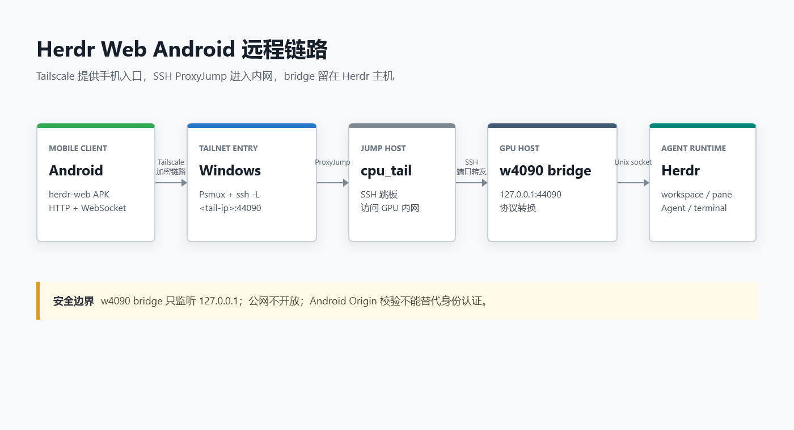
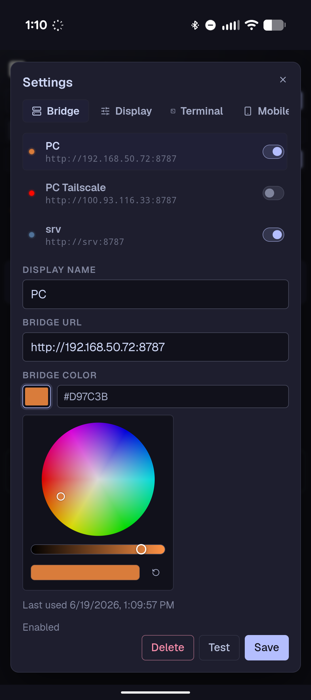
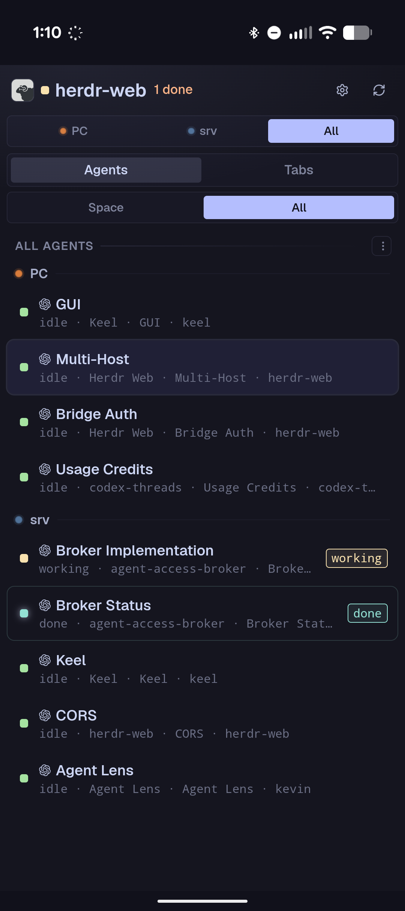
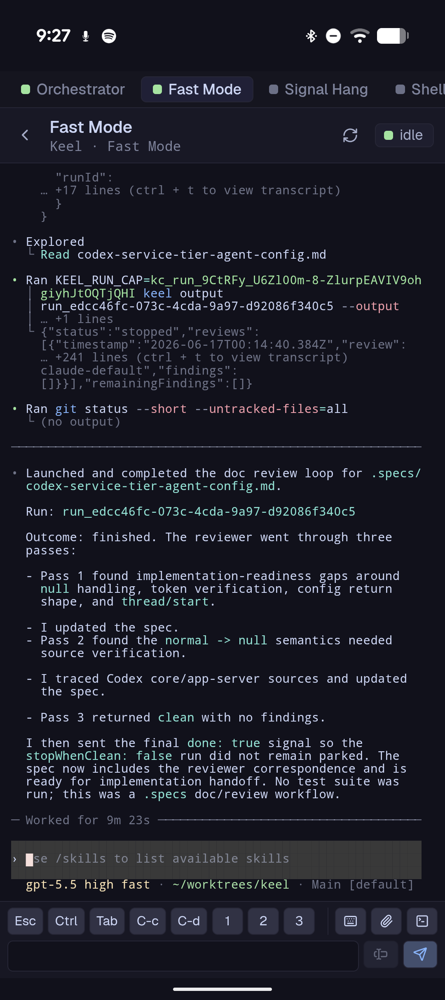

# Herdr Web Android 远程连接部署记录

我想在手机上查看和操作 Herdr 里的 Agent，会碰到一个实际限制：Android 客户端本身不运行 Herdr，`herdr-web` 的 APK 只是前端，真正的 bridge 必须运行在能访问 Herdr 本地 socket 的主机上。

这篇记录两种已经验证的部署方式：

1. Windows 主机本身运行 Herdr，并且安装了 Tailscale。
2. `w4090` 主机没有 Tailscale，只能通过 `cpu_tail` 跳板访问。

验证环境如下：

| 组件 | 版本或状态 |
|------|------------|
| Herdr（Windows） | `0.7.4-preview`，protocol `16` |
| Herdr（w4090） | `0.7.3`，protocol `16` |
| `herdr-web` | `v0.3.3` |
| Windows 终端复用器 | Psmux 3.3.2，命令别名为 `tmux` |

## 1. 连接原理

远程主机没有 Tailscale 时，完整链路如下：



`herdr-web-bridge` 负责协议转换：

- HTTP API 读取 workspace、tab、pane 和 Agent 状态，并执行受限的管理命令。
- WebSocket 传输终端画面、键盘输入、滚动、resize 和 Agent 活动事件。
- Linux 上连接 `~/.config/herdr/herdr.sock` 和 `herdr-client.sock`。
- Windows 上连接 `%APPDATA%\herdr\herdr.sock` 和 `herdr-client.sock`，底层对应 Windows named pipe。

所以 bridge 必须和 Herdr 在同一台机器上，Android 只需要访问 bridge 的 HTTP/WebSocket 端口。

## 2. 准备 Android 客户端

从 [`herdr-web` v0.3.3 Release](https://github.com/kcosr/herdr-web/releases/tag/v0.3.3) 下载 `herdr-web-v0.3.3-android-debug.apk`。在 Android 上允许安装未知来源应用后完成安装。

打开应用后：

1. 进入 `Settings`。
2. 打开 `Bridge` 区域。
3. 输入 bridge URL。
4. 点击 `Test`，确认可达后点击 `Save`。
5. 打开保存项的 `Enable` 开关。

APK 启动时默认是 disconnected 状态，这是正常行为。它需要先保存一个 bridge URL。

以下 Android 界面截图来自 [`herdr-web/docs/images`](https://github.com/kcosr/herdr-web/tree/main/docs/images)。Bridge 设置页可以保存多个入口，并分别测试、启用和设置标识颜色：



连接成功后，可以按 Bridge、Agent 和 Tab 筛选不同主机上的会话：



## 3. Windows 主机原生部署

### 3.1 构建 bridge

上游目前没有 Windows 预编译 bridge。Windows 主机需要 Node.js、npm、Rust 和 Cargo：

```powershell
git clone https://github.com/kcosr/herdr-web.git
Set-Location herdr-web

# 根目录依赖和 web 子项目依赖分别安装
npm ci
npm ci --prefix web

# 构建前端和 Windows release bridge
npm run build:web
cargo build --release --manifest-path bridge\Cargo.toml --bin herdr-web-bridge
```

构建结果位于：

```text
bridge/target/release/herdr-web-bridge.exe
web/dist/
```

Windows 原生构建时要注意两个平台差异：

- Windows 不能像 Unix 一样直接 `File::open(parent).sync_all()`，Notes 和 Agent Pins 的原子写入需要在 Windows 跳过目录同步。
- Windows 通常没有 `HOME` 环境变量，用户目录应回退到 `USERPROFILE`。

这两个问题不会改变 bridge 协议，但会影响运行时存储和 workspace 标签。

### 3.2 启动 bridge

Herdr 已经在本机运行时，先确认 socket：

```powershell
herdr status server --json
Test-Path "$env:APPDATA\herdr\herdr.sock"
Test-Path "$env:APPDATA\herdr\herdr-client.sock"
```

假设 Windows 的 Tailscale 地址是 `<windows-tail-ip>`，bridge 使用 `4000`：

```powershell
$env:HERDR_SOCKET_PATH = "$env:APPDATA\herdr\herdr.sock"
$env:HERDR_WEB_UPLOAD_DIR = "$env:LOCALAPPDATA\herdr-web\uploads"
$env:HERDR_WEB_NOTES_DIR = "$env:LOCALAPPDATA\herdr-web\notes"
$env:HERDR_WEB_AGENT_PINS_DIR = "$env:LOCALAPPDATA\herdr-web\agent-pins"

.\bridge\target\release\herdr-web-bridge.exe `
  --host <windows-tail-ip> `
  --port 4000 `
  --static-dir .\web\dist `
  --allow-origin http://localhost
```

Android 中填写：

```text
http://<windows-tail-ip>:4000
```

bridge 没有完整的用户认证。`--allow-origin http://localhost` 只是允许 Android WebView 的 origin，不是登录机制。只绑定 Tailscale 地址，并在 Windows 防火墙中限制端口来源。

## 4. w4090 没有 Tailscale 时的部署

### 4.1 SSH 跳板配置

这里让 bridge 留在 w4090，因为它需要访问 w4090 的 Herdr Unix socket；当前 Windows 只负责 SSH 转发和 Tailscale 入口。

SSH 配置结构如下：

```text
Host cpu_tail
    HostName <cpu-tail-ip>
    User <cpu-user>
    Port <cpu-ssh-port>

Host w4090_host_tail
    HostName <w4090-internal-ip>
    User <w4090-user>
    Port <w4090-ssh-port>
    ProxyJump cpu_tail
```

为了不和 Windows 本机 bridge 的 `4000` 冲突，远端链路使用 `44090`。

### 4.2 在 w4090 放置 release 包

w4090 没有 Rust 时，直接使用官方 Linux x86_64 release 包。包放在 `/workspace/code`，并校验 SHA256：

```bash
cd /workspace/code

curl -fL -O https://github.com/kcosr/herdr-web/releases/download/v0.3.3/herdr-web-v0.3.3-linux-x86_64.tar.gz
curl -fL -O https://github.com/kcosr/herdr-web/releases/download/v0.3.3/herdr-web-v0.3.3-linux-x86_64.tar.gz.sha256

sha256sum -c herdr-web-v0.3.3-linux-x86_64.tar.gz.sha256
tar -xzf herdr-web-v0.3.3-linux-x86_64.tar.gz
```

确认 w4090 上的 Herdr：

```bash
export HERDR_SOCKET_PATH=/root/.config/herdr/herdr.sock
test -S "$HERDR_SOCKET_PATH"
test -S /root/.config/herdr/herdr-client.sock
/root/.local/bin/herdr status server --json
```

### 4.3 在 w4090 的 tmux 中启动 bridge

下面的 `<windows-tail-ip>` 是当前 Windows 的 Tailscale IPv4。`--allow-host` 必须允许 Android 请求经过 SSH 转发后携带的 Host。

```bash
mkdir -p /workspace/code/herdr-web-runtime/{uploads,notes,agent-pins}

tmux new-session -d -s herdr-web-w4090 \
  'cd /workspace/code/herdr-web-v0.3.3-linux-x86_64 && \
   HERDR_SOCKET_PATH=/root/.config/herdr/herdr.sock \
   HERDR_WEB_UPLOAD_DIR=/workspace/code/herdr-web-runtime/uploads \
   HERDR_WEB_NOTES_DIR=/workspace/code/herdr-web-runtime/notes \
   HERDR_WEB_AGENT_PINS_DIR=/workspace/code/herdr-web-runtime/agent-pins \
   exec ./bin/herdr-web \
     --host 127.0.0.1 \
     --port 44090 \
     --allow-host <windows-tail-ip> \
     --allow-origin http://localhost \
     >> /workspace/code/herdr-web-runtime/bridge.log 2>&1'
```

确认 bridge 只监听回环地址：

```bash
tmux list-panes -t herdr-web-w4090 -F '#{session_name}|#{pane_current_command}|#{pane_dead}'
ss -ltnp | grep ':44090 '
```

预期结果是 `127.0.0.1:44090`，而不是 `0.0.0.0:44090`。

### 4.4 在当前 Windows 的 psmux/tmux 中做 SSH 转发

当前机器的 `tmux` 是 Psmux 的命令别名，使用现有的 `w4090_host_tail` 配置时，`ProxyJump cpu_tail` 会自动生效：

```powershell
tmux new-session -d -s herdr-web-w4090-tunnel "ssh.exe -NT -o ExitOnForwardFailure=yes -o ServerAliveInterval=30 -o ServerAliveCountMax=3 -L <windows-tail-ip>:44090:127.0.0.1:44090 w4090_host_tail"
```

检查本地转发：

```powershell
tmux list-sessions
tmux list-panes -t herdr-web-w4090-tunnel -F "#{session_name}|#{pane_current_command}|#{pane_dead}"
Get-NetTCPConnection -LocalAddress <windows-tail-ip> -LocalPort 44090 -State Listen
```

Android 最终填写：

```text
http://<windows-tail-ip>:44090
```

外部监听端口和 w4090 bridge 端口都使用 `44090`。`herdr-web` 会校验 Host 的端口；外部端口和 bridge 端口不一致时，需要用反向代理重写 Host，或者让 bridge 使用外部端口。

## 5. 验证整条链路

先在 w4090 直连 bridge：

```bash
curl -fsS \
  -H 'Host: <windows-tail-ip>:44090' \
  -H 'Origin: http://localhost' \
  http://127.0.0.1:44090/api/snapshot
```

再在当前 Windows 通过 SSH 隧道验证：

```powershell
$headers = @{ Origin = "http://localhost" }
$capabilities = Invoke-WebRequest `
  -UseBasicParsing `
  -Headers $headers `
  -Uri "http://<windows-tail-ip>:44090/api/capabilities"

$snapshot = Invoke-RestMethod `
  -Headers $headers `
  -Uri "http://<windows-tail-ip>:44090/api/snapshot"

[PSCustomObject]@{
  CapabilitiesStatus = $capabilities.StatusCode
  AllowOrigin        = $capabilities.Headers["Access-Control-Allow-Origin"]
  Workspaces         = $snapshot.workspaces.Count
  Tabs               = $snapshot.tabs.Count
  Panes              = $snapshot.panes.Count
  Layouts            = $snapshot.layouts.Count
}
```

实际验证中，Windows 本地 bridge 返回 1 个 workspace、6 个 tab、6 个 pane；经过 SSH/ProxyJump 转发后，w4090 bridge 返回 10 个 workspace、33 个 tab、35 个 pane。两条链路的 API 和 Android CORS 均返回 `200`。

进入具体 pane 后，终端输出、输入框和常用控制键都在同一个移动端界面中：



## 6. Windows 防火墙

Android 无法连接时，在管理员 PowerShell 中给 bridge 或 `ssh.exe` 添加仅限 Tailscale 网段的规则。SSH 隧道示例：

```powershell
New-NetFirewallRule `
  -DisplayName "herdr-web SSH tunnel (Tailscale)" `
  -Direction Inbound `
  -Action Allow `
  -Protocol TCP `
  -LocalAddress <windows-tail-ip> `
  -LocalPort 44090 `
  -RemoteAddress 100.64.0.0/10 `
  -Profile Private `
  -Program "C:\Windows\System32\OpenSSH\ssh.exe"
```

不要把端口直接放开到公网，也不要把 w4090 bridge 绑定到 `0.0.0.0`。

## 7. 常见问题

### 7.1 Android 的 `Test` 失败

按下面顺序检查：

1. Android 和当前 Windows 是否连接到同一个 Tailscale tailnet。
2. `tmux list-panes -t herdr-web-w4090-tunnel` 中的 SSH pane 是否还活着。
3. 当前 Windows 是否监听 `<windows-tail-ip>:44090`。
4. w4090 是否监听 `127.0.0.1:44090`。
5. Windows 防火墙是否允许 Tailscale 网段访问 `44090`。

### 7.2 返回 `403 cross-origin requests are not allowed`

重点检查三个值：

- bridge 是否有 `--allow-origin http://localhost`。
- `--allow-host` 是否填写外部访问时的 Host，而不是 `127.0.0.1`。
- SSH 转发的外部端口和 bridge 的 `--port` 是否一致。

### 7.3 非交互 SSH 找不到 Herdr

直接指定 Herdr binary 和 socket：

```bash
export HERDR_SOCKET_PATH=/root/.config/herdr/herdr.sock
/root/.local/bin/herdr status server --json
```

## 8. 管理命令

```powershell
# 查看或停止当前 Windows 上的隧道
tmux attach -t herdr-web-w4090-tunnel
tmux kill-session -t herdr-web-w4090-tunnel

# 查看或停止 w4090 上的 bridge
ssh -t w4090_host_tail "tmux attach -t herdr-web-w4090"
ssh w4090_host_tail "tmux kill-session -t herdr-web-w4090"
```

这套部署依赖当前 Windows 在线并保持本地隧道 session。需要长期运行时，再把远端 bridge 和本地 SSH 转发分别注册为 `systemd` 服务或 Windows 计划任务。

## 9. 参考链接

- [`herdr-web`](https://github.com/kcosr/herdr-web)
- [`herdr-web v0.3.3 Release`](https://github.com/kcosr/herdr-web/releases/tag/v0.3.3)
- [`Herdr`](https://github.com/ogulcancelik/herdr)
- [`Psmux 使用备忘`](../psmux/index.md)
- [`SSH 命令备忘`](../ssh-guide/index.md)
- [`Tailscale`](https://tailscale.com/)
